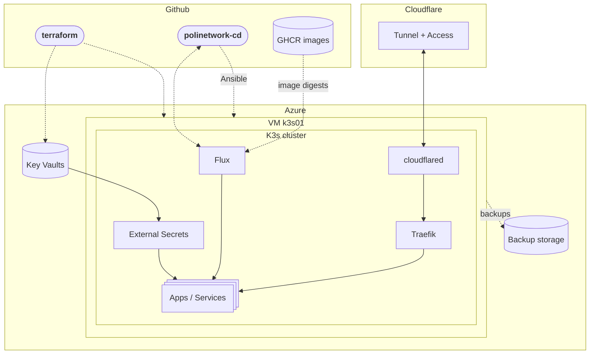

## Overview

This section explains how we organized our infrastructure.

Everything regarding the deployment of apps and services is divided into two repositories:

- [polinetworkorg/terraform](https://github.com/polinetworkorg/terraform) - Contains the Terraform code for the Azure resources: the `k3s01` VM, its disks and network, the Key Vaults, the managed identities, the backup storage account.
- [polinetworkorg/polinetwork-cd](https://github.com/polinetworkorg/polinetwork-cd) - Our GitOps repo. It contains the Ansible playbooks that turn the VM into a K3s node, and the Kubernetes manifests of every app and service. Flux, running in the cluster, applies them.

### **Terraform: Definition and Purpose**  

The **Terraform** repository is responsible for managing and provisioning cloud infrastructure. In simple terms, it defines and creates the resources needed for the infrastructure, such as:  

- **Networks and subnets** (Virtual Network, NAT Gateway for outbound traffic, Network Security Group)
- **Virtual machines** (the `k3s01` K3s node)
- **Storage** (Managed Disks for the node, Blob Storage for backups and Terraform state)
- **Security services** (Key Vaults, managed identities, workload identity federation)

The code in **Terraform** describes these resources declaratively: it defines the desired state, and Terraform applies the necessary changes to reach that state. This repository is primarily used to **create and modify the cloud infrastructure** where applications will run.

Terraform stops at the Azure boundary: it creates the VM, but it doesn't configure
what runs inside it.

### **PoliNetwork-CD: Definition and Purpose**  

The **PoliNetwork-CD** (Continuous Deployment) repository picks up where Terraform stops. It has two parts:

- **`ansible/`** configures the VM: it mounts the data disks, hardens SSH and the
  firewall, installs a pinned K3s version, schedules the encrypted backups and
  bootstraps Flux. You run it by hand, rarely.
- **`clusters/k3s/`, `infrastructure/` and `apps/`** describe everything inside
  Kubernetes. **Flux** watches the `main` branch and applies it continuously, so you
  never run `kubectl apply` by hand.

Through Flux, the repository is used to:

- **Define application deployments** in Kubernetes (plain manifests organized with Kustomize, or Helm charts)
- **Automatically update applications** when a new `latest` image is published
- **Manage application configurations** (environment variables, secrets pulled from Key Vault)
- **Monitor the state of applications** and ensure they remain in sync with the repository

While Terraform is responsible for infrastructure, **PoliNetwork-CD** focuses on **managing the lifecycle of applications** running on that infrastructure, ensuring that code changes are applied automatically and securely.  

### **Key Difference: Infrastructure vs. Deployment**

| Repository | Main Purpose | Example of Managed Resources |
|------------|--------------|------------------------------|
| **Terraform** | Creates and manages cloud infrastructure | VM, disks, network, Key Vaults, identities |
| **PoliNetwork-CD** (`ansible/`) | Configures the VM | Disk mounts, firewall, SSH, K3s, backups |
| **PoliNetwork-CD** (Flux) | Automates application deployment and updates | Deployments, ingresses, secrets, storage |

In summary, **Terraform builds the foundation on which applications run**, while **PoliNetwork-CD sets up the node and manages the deployment and continuous updating of applications**. Both repositories work together to ensure a scalable and efficient cloud infrastructure.

### How a request reaches an app

1. A visitor opens e.g. `https://api.polinetwork.org`. DNS points to Cloudflare.
2. Cloudflare sends the request through the `k3s01` tunnel to one of the two
   `cloudflared` pods in the cluster.
3. `cloudflared` forwards it to **Traefik**, the K3s ingress controller.
4. Traefik picks the app from the `Ingress` whose `host` matches, and forwards the
   request to that app's `Service`.

The VM never accepts inbound connections from the Internet: the tunnel is an
outbound connection, and outbound traffic leaves Azure through a NAT Gateway.

<Cards>
  <Card
    title="Terraform"
    href="/docs/infrastructure/getting-started/cloud-infrastructure/terraform"
    description="Detailed overview of our Azure-based infrastructure managed via the polinetworkorg/terraform repository."
  />
  <Card
    title="K3s Node"
    href="/docs/infrastructure/getting-started/cloud-infrastructure/k3s-node"
    description="The k3s01 VM, how Ansible configures it, and how to run the playbooks."
  />
  <Card
    title="Flux"
    href="/docs/infrastructure/getting-started/cloud-infrastructure/flux"
    description="How Flux deploys the polinetwork-cd repository to the K3s cluster."
  />
</Cards>

## References

### **Links to Repositories**

- [Terraform Repository](https://github.com/polinetworkorg/terraform)
- [PoliNetwork-CD Repository](https://github.com/polinetworkorg/polinetwork-cd)

### **Additional Resources**

- [Kubernetes Documentation](https://kubernetes.io/docs/)
- [K3s Documentation](https://docs.k3s.io/)
- [Flux Documentation](https://fluxcd.io/flux/)
- [Terraform Documentation](https://www.terraform.io/docs/)
