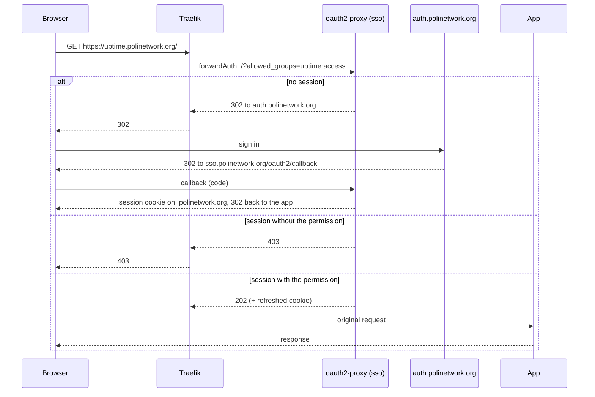

## Overview

Some apps have no login of their own, or one we'd rather not maintain (e.g. Uptime Kuma).
For those, Traefik asks an **SSO gateway** whether each request may go through. The
gateway signs people in with [PoliNetwork Auth](https://auth.polinetwork.org) and lets
through only people who hold the permission that app requires.

The gateway is [oauth2-proxy](https://oauth2-proxy.github.io/oauth2-proxy/), deployed from
`infrastructure/sso` in [polinetwork-cd](https://github.com/PoliNetworkOrg/polinetwork-cd).
It replaces Cloudflare Access for HTTP apps. SSH to the node still goes through
Cloudflare Access for Infrastructure (see [Setup](/docs/infrastructure/getting-started/setup)).

<Callout type="info" title="Apps with their own OIDC login">

Apps that can sign people in with OIDC themselves (Grafana, the Flux Web UI, Vaultwarden,
our own apps) keep doing so with their own client on PoliNetwork Auth. The gateway is for
everything else.

</Callout>

## How a request goes through

1. The app's `Ingress` references a Traefik `forwardAuth` **Middleware**. Before routing
   the request, Traefik sends its headers to oauth2-proxy at
   `http://oauth2-proxy.sso.svc.cluster.local:4180/?allowed_groups=<permission>`.
2. Without a session, oauth2-proxy redirects to PoliNetwork Auth (authorization code
   flow with PKCE). After sign-in, Auth sends the browser back to
   `https://sso.polinetwork.org/oauth2/callback`, which sets the session cookie and
   returns the visitor to the page they asked for.
3. With a session, oauth2-proxy checks the permission. It answers `202` and Traefik
   forwards the request to the app, or `403` and the visitor sees an error page.

All protected apps share **one** client on Auth (*SSO Gateway*) and **one** redirect URI.
Adding an app doesn't touch Auth's application list: it only needs a permission.

## Permissions

The Middleware names the permission in `allowed_groups`. oauth2-proxy reads it from the
`polinetwork_permission_list` claim, the array version of `polinetwork_permissions`, which
it requests with the `polinetwork:identity` scope.

- It checks **permissions**, never roles. The `groups` claim holds role keys and must not
  be used for access.
- By convention, each app has its own `<app>:access` permission (e.g. `uptime:access`),
  granted to the roles that should use it. Granting a role a permission is done on Auth,
  not in Git.

## Sessions

- **The cookie.** The session lives in an encrypted, `HttpOnly`, `Secure` cookie named
  `__Secure-pn_sso`, set on `.polinetwork.org`. One sign-in covers every protected host.
  Large sessions are split into `__Secure-pn_sso_0`, `_1`, and so on. Nothing is stored
  server-side, so the two oauth2-proxy replicas are interchangeable.
- **Refresh.** Auth's ID and access tokens last 5 minutes. After 4 minutes, the next
  request makes oauth2-proxy use the refresh token (`offline_access`) to get new ones, and
  re-read the permissions. Losing a permission or a role takes effect within about 5
  minutes, without signing out.
- **Rotation.** Auth rotates the refresh token on every use, so the refreshed cookie
  **must** reach the browser. That is what `addAuthCookiesToResponse` in the Middleware
  does. Without it, the browser keeps sending a refresh token that has already been used.
- **Lifetime.** The cookie lasts 24 hours. After that, the visitor goes through Auth
  again, usually without typing anything if their Auth session is still active.
- **Sign-out.** `https://sso.polinetwork.org/oauth2/sign_out` deletes the cookie. It does
  not end the session on Auth.

## Security notes

- **Only Traefik may reach a protected app.** The gateway protects the route, not the
  pod. Every app behind it has a `NetworkPolicy` that admits only Traefik, or another pod
  in the cluster could call its Service directly. This matters most for apps whose own
  login is disabled.
- **Everything else on the app's host is public.** If a host serves both a private and a
  public part, as Uptime Kuma does with its status page, the public part needs its own
  `Ingress` that lists only the public paths.
- **It fails closed.** If oauth2-proxy is down, protected apps return errors; they don't
  open up.
- **The cookie is a bearer credential.** Browsers send it to every `*.polinetwork.org`
  host, including apps not behind the gateway. That is the price of one sign-in for all
  apps; every host on the domain is ours.
- **Forwarded headers.** Traefik's `web` entrypoint trusts `X-Forwarded-*` from the pod
  network, where `cloudflared` runs. oauth2-proxy uses `X-Forwarded-Proto` and
  `X-Forwarded-Host` to send visitors back to `https://<host>/...`, and only to
  `.polinetwork.org` hosts (`--whitelist-domain`).
- **Rate limits.** Refreshes call Auth's token endpoint from inside the cluster, so they
  count against Auth's shared budget of 60 cluster-internal token requests per minute.
  That's plenty for staff dashboards; don't put a high-traffic public app behind the
  gateway.

## Where things live

| What | Where |
|------|-------|
| oauth2-proxy Deployment, Service, Ingress, NetworkPolicy | `infrastructure/sso/` |
| Client secret and cookie secret | Key Vault `kv-pn-infra`: `sso-oidc-client-secret`, `sso-cookie-secret` |
| The *SSO Gateway* client | [auth.polinetwork.org/applications](https://auth.polinetwork.org/applications) |
| Trusted forwarded headers | `infrastructure/traefik/traefik-service.yaml` |
| Per-app Middleware (example) | `apps/uptime-kuma/middleware.yaml` |

To put an app behind the gateway, follow [Protect an App with SSO](/docs/infrastructure/Guides/protect-an-app-with-sso).
