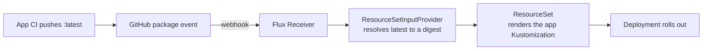

# Flux (/docs/infrastructure/getting-started/cloud-infrastructure/flux)

## What is Flux? [#what-is-flux]

[Flux](https://fluxcd.io/) is a GitOps tool: it runs inside the cluster, watches a
Git repository and applies whatever it finds there, over and over. If someone
changes a resource by hand, Flux puts it back the way Git says. It replaced the
ArgoCD instance we had on AKS.

Ours is installed by Ansible through the
[Flux Operator](https://fluxcd.control-plane.io/operator/), and it syncs the
**`main`** branch of
[polinetwork-cd](https://github.com/polinetworkorg/polinetwork-cd), starting
from the `clusters/k3s` folder.

<Callout type="important">

Merging to `main` in polinetwork-cd **is** deploying to production.
Never `kubectl apply` or `kubectl edit` a resource that Flux manages: Flux reverts
it at the next reconciliation.

</Callout>

## Repository layout [#repository-layout]

```bash
📁 polinetworkorg/polinetwork-cd/
 ├─ 📁 ansible/                 # Host configuration (see K3s Node)
 ├─ 📁 clusters/k3s/            # Entry point: one Flux Kustomization per component
 │   ├─ infrastructure-*.yaml   # Platform components
 │   └─ 📁 apps/                # One file per app + kustomization.yaml listing them
 ├─ 📁 infrastructure/          # Manifests of the platform components
 ├─ 📁 apps/                    # Manifests of the apps, one folder per namespace
 │   ├─ 📁 backend/
 │   ├─ 📁 web/
 │   └─ ...
 └─ 📁 tests/                   # Manifest checks run in CI
```

Folders at the root of the repository (`bot-prod/`, `bot-rooms/`, `mariadb/`, ...)
are leftovers from the AKS era, all disabled. Flux ignores them.

### `clusters/k3s` [#clustersk3s]

Each file here is a Flux
[`Kustomization`](https://fluxcd.io/flux/components/kustomize/kustomizations/)
that points to one folder of `infrastructure/` or `apps/`. It also sets:

- `dependsOn`: what must be ready first. Apps wait for the secret stores, storage
  and Traefik; `backend` also waits for `postgres` and `redis`.
- `prune: true`: a resource removed from Git is deleted from the cluster.
- `wait: true`: the Kustomization is ready only when all its resources are healthy.
- `interval: 30m`: a full reconciliation at least every 30 minutes, even if Git
  didn't change.

`clusters/k3s/apps/kustomization.yaml` lists the apps Flux runs. An app file
that is not listed there does nothing.

### Platform components (`infrastructure/`) [#platform-components-infrastructure]

| Component | What it does |
|-----------|--------------|
| `security` | Admission policies (no host namespaces, no pods as `keyvault-reader`) |
| `storage` | [local-path provisioner](https://github.com/rancher/local-path-provisioner) and the `fast` / `standard` storage classes |
| `traefik` | Makes the bundled Traefik a `ClusterIP` service |
| `external-secrets` | [External Secrets Operator](https://external-secrets.io/), installed with Helm |
| `secret-stores` | The `kv-pn-apps` and `kv-pn-infra` `ClusterSecretStore`s |
| `cloudflared` | The Cloudflare Tunnel connector (2 replicas) |
| `image-automation` | Detects new `latest` images on GHCR (see below) |
| `node-exporter` | Node metrics for Prometheus |
| `flux-web` | The Flux Web UI at [flux.polinetwork.org](https://flux.polinetwork.org) |

## Automatic image updates [#automatic-image-updates]

Most of our apps are deployed from the `latest` tag of an image on
[GHCR](https://github.com/orgs/PoliNetworkOrg/packages). A tag can point to a
different image over time, so Flux resolves it to a **digest** and deploys that
digest. When the digest changes, the app rolls out the new image.



The pieces, all in polinetwork-cd:

- `infrastructure/image-automation/image-providers.yaml`: one
  `ResourceSetInputProvider` per image, which reads the `latest` tag and its digest.
- `infrastructure/image-automation/receiver.yaml`: a Flux `Receiver` called by
  the PoliNetworkOrg organization webhook on `package` events, at
  `flux-webhook.polinetwork.org`. The webhook's HMAC signature is its only
  authentication. If the webhook doesn't fire, the providers poll every 6 hours anyway.
- `clusters/k3s/apps/<app>.yaml`: for apps with automatic updates this is a
  `ResourceSet` instead of a plain Kustomization. It generates the app's
  Kustomization with an `images` override that pins the digest.

Apps that don't need automatic updates (databases, monitoring, ...) pin their
image in the manifest, and you bump them with a PR.

## Day-to-day [#day-to-day]

### Web UI [#web-ui]

[flux.polinetwork.org](https://flux.polinetwork.org) shows every Kustomization,
HelmRelease and ResourceSet, with its status, last applied revision and errors.
You log in through [auth.polinetwork.org](https://auth.polinetwork.org); only
the Direttivo is admitted. From the UI you can **reconcile** (sync now),
**suspend** and **resume** any resource.

### From the node [#from-the-node]

The `flux` CLI isn't installed on the node, but the Flux resources are regular
Kubernetes objects:

```sh
# Status of all the Kustomizations (apps and infrastructure)
kubectl get kustomizations -n flux-system

# Latest image resolved for each app
kubectl get resourcesetinputproviders -n flux-system

# Why is an app not ready?
kubectl describe kustomization <app> -n flux-system

# Sync now instead of waiting: fetch the latest commit, then apply it
kubectl annotate --overwrite gitrepository flux-system -n flux-system \
  reconcile.fluxcd.io/requestedAt="$(date +%s)"
kubectl annotate --overwrite kustomization <app> -n flux-system \
  reconcile.fluxcd.io/requestedAt="$(date +%s)"
```

<Callout type="tip" title="Suspending an app">

To stop Flux from touching an app while you debug it by hand, **suspend** its
Kustomization from the Web UI. Remember to **resume** it afterwards: a suspended
app also stops receiving image updates.

</Callout>

## References [#references]

- [Flux Documentation](https://fluxcd.io/flux/)
- [Flux Operator Documentation](https://fluxcd.control-plane.io/operator/)
- [ResourceSets](https://fluxcd.control-plane.io/operator/resourcesets/introduction/)
- [PoliNetwork-CD Repository](https://github.com/polinetworkorg/polinetwork-cd)
